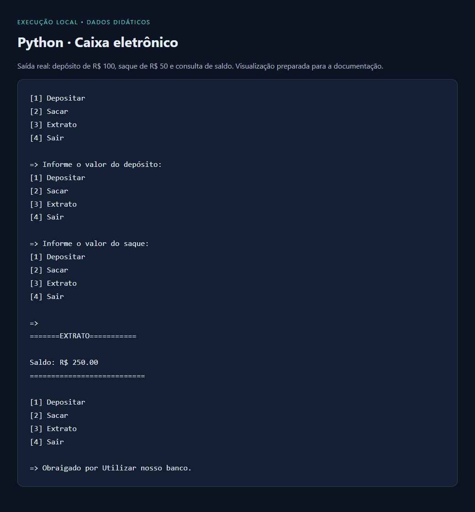

# Python · Exercícios de lógica e automação de terminal

Coleção de programas em Python 3 que transformam enunciados acadêmicos em rotinas interativas. Os exemplos trabalham com condicionais, laços, listas, acumulação de valores e formatação de saída.

**Tipo:** estudos de programação · **Interface:** terminal · **Dependências:** biblioteca padrão do Python.

## Projetos incluídos

| Arquivo | O que demonstra |
|---|---|
| [Sistema_Caixa_Eletronico.py](Sistema_Caixa_Eletronico.py) | Menu com depósito, saque, limite de saques e consulta de saldo em memória. |
| [Sistema_Votacao_Live.py](Sistema_Votacao_Live.py) | Coleta de votos para dias da semana, contagem e identificação de empates. |
| [Renegociacao.py](Renegociacao.py) | Tabela de parcelas e juros conforme valores definidos no exercício. |
| [SistemaParcelaJuros.py](SistemaParcelaJuros.py) | Comparação didática de compra à vista e parcelada. |
| [Plano_Assinatura.py](Plano_Assinatura.py) | Seleção de plano e cálculo de bônus por categoria. |
| [Investimentos.py](Investimentos.py) | Uso de condicionais em um cenário didático de resgate de investimento. |
| [Calorias_Ingeridas_Diarias.py](Calorias_Ingeridas_Diarias.py) | Soma de valores informados em uma sequência de entradas. |
| [Verificar_batimentos_cardiacos.py](Verificar_batimentos_cardiacos.py) | Exercício de faixas e comparações com idade e valores de entrada. |
| [Validar_Usuario_Senha.py](Validar_Usuario_Senha.py) | Comparação de texto com valores fixos em um exemplo de validação. |

## Demonstração

Saída real do caixa eletrônico com dados didáticos: saldo inicial de R$ 200, depósito de R$ 100, saque de R$ 50 e consulta de saldo. A imagem é uma visualização da saída capturada, preparada para leitura na documentação.



## Executar

Instale Python 3 e abra o terminal na pasta do repositório. Não é necessário instalar pacotes adicionais.

```sh
python Sistema_Caixa_Eletronico.py
python Sistema_Votacao_Live.py
```

Execute um arquivo por vez e responda às perguntas do terminal. Em ambientes que usam `python3`, substitua o nome do comando.

## Escopo dos exercícios

São implementações acadêmicas com regras simplificadas e sem persistência. O arquivo de caixa eletrônico mantém um texto de movimentações internamente, mas a opção de extrato atualmente exibe o saldo. Os exemplos financeiros e de saúde não são aplicações para decisões reais; as regras desses enunciados e a validação de entradas ainda precisam de revisão. A validação de usuário com valores fixos é um exercício de comparação, sem autenticação segura.
