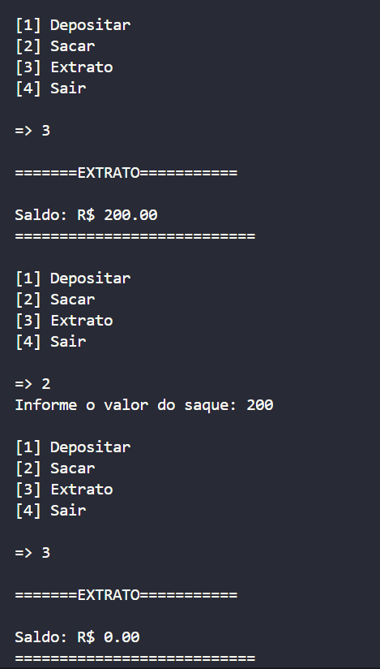
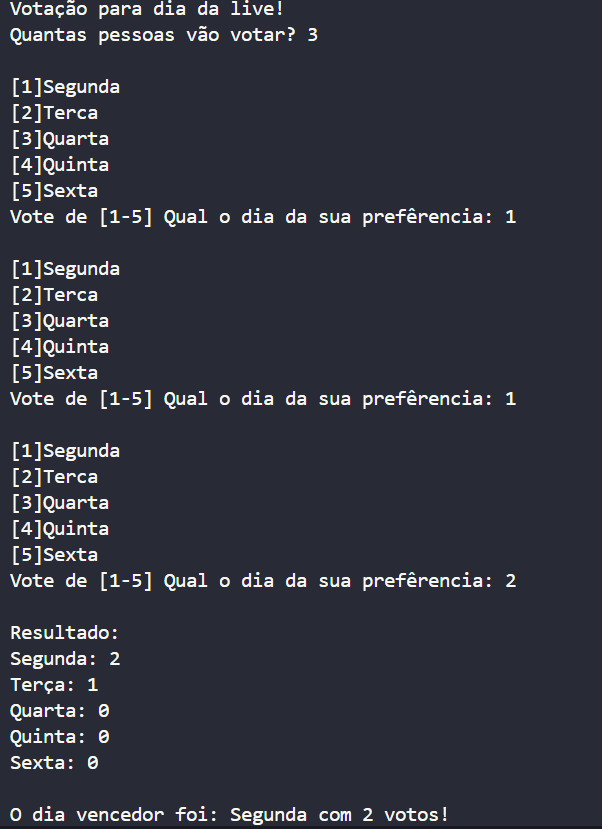
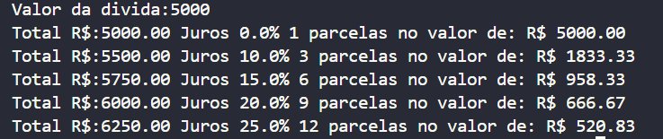
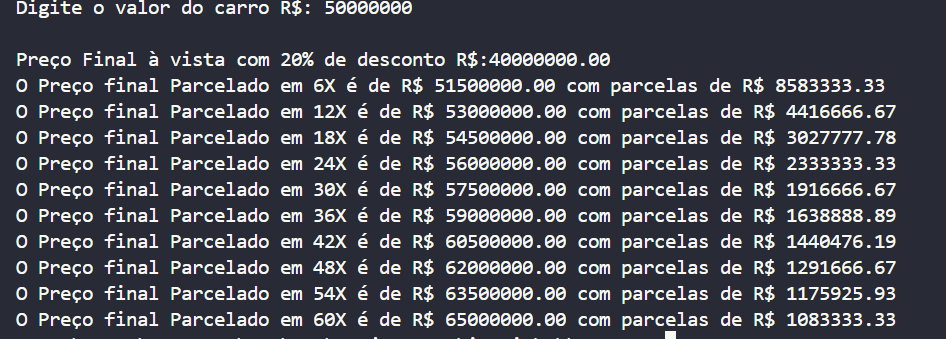
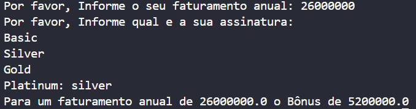
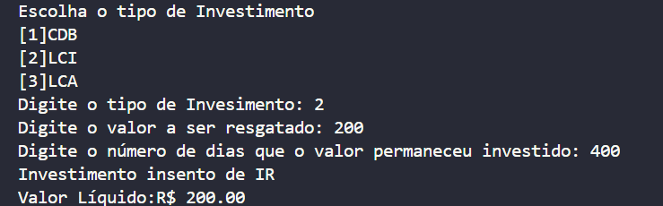
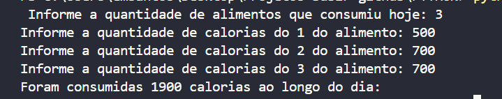
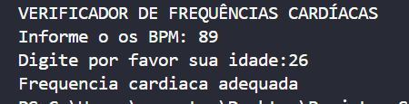
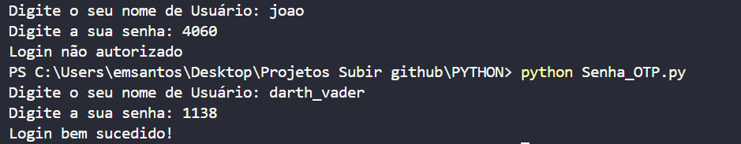

# Python · Exercícios de lógica e automação de terminal

Coleção de programas em Python 3 que transformam enunciados acadêmicos em rotinas interativas. Os exemplos trabalham com condicionais, laços, listas, acumulação de valores e formatação de saída.

**Tipo:** estudos de programação · **Interface:** terminal · **Dependências:** biblioteca padrão do Python.

## Projetos incluídos

| Arquivo | O que demonstra |
|---|---|
| [Sistema_Caixa_Eletronico.py](Sistema_Caixa_Eletronico.py) | Menu com depósito, saque, limite de saques e consulta de saldo em memória. |
| [Sistema_Votacao_Live.py](Sistema_Votacao_Live.py) | Coleta de votos para dias da semana, contagem e identificação de empates. |
| [Renegociacao.py](Renegociacao.py) | Tabela de parcelas e juros conforme valores definidos no exercício. |
| [SistemaParcelaJuros.py](SistemaParcelaJuros.py) | Comparação didática de compra à vista e parcelada. |
| [Plano_Assinatura.py](Plano_Assinatura.py) | Seleção de plano e cálculo de bônus por categoria. |
| [Investimentos.py](Investimentos.py) | Uso de condicionais em um cenário didático de resgate de investimento. |
| [Calorias_Ingeridas_Diarias.py](Calorias_Ingeridas_Diarias.py) | Soma de valores informados em uma sequência de entradas. |
| [Verificar_batimentos_cardiacos.py](Verificar_batimentos_cardiacos.py) | Exercício de faixas e comparações com idade e valores de entrada. |
| [Validar_Usuario_Senha.py](Validar_Usuario_Senha.py) | Comparação de texto com valores fixos em um exemplo de validação. |

## Saídas e explicações dos programas

As nove capturas originais foram recuperadas do histórico do repositório. Cada programa abaixo reúne a explicação, o código correspondente e um exemplo de saída.

### Caixa eletrônico

**Código:** [Sistema_Caixa_Eletronico.py](Sistema_Caixa_Eletronico.py)

Simula um caixa eletrônico com menu de depósito, saque, consulta de saldo e saída. Começa com R$ 200,00 em memória, permite até três saques e verifica saldo disponível, limite de R$ 1.000,00 por saque e valores positivos. A opção chamada **Extrato** exibe o saldo atual.

**Conceitos praticados:** repetição com `while`, decisões com `if/elif/else`, atualização de variáveis e formatação de valores.

**Na captura:** consulta do saldo inicial de R$ 200,00, saque de R$ 200,00 e nova consulta com saldo de R$ 0,00.



### Votação para o dia de uma live

**Código:** [Sistema_Votacao_Live.py](Sistema_Votacao_Live.py)

Recebe a quantidade de participantes e coleta a preferência de cada um entre segunda e sexta-feira. Conta os votos, exibe o resultado por dia e informa o vencedor ou os dias empatados. Repete a pergunta quando a quantidade informada é menor ou igual a zero ou o voto numérico está fora das opções de 1 a 5.

**Conceitos praticados:** laços `for` e `while`, contadores, validação de opções e comparação de resultados.

**Na captura:** três participantes votam; segunda-feira recebe dois votos e terça-feira recebe um. O programa anuncia segunda-feira como vencedora.



### Renegociação de dívida

**Código:** [Renegociacao.py](Renegociacao.py)

Recebe o valor de uma dívida e monta uma tabela com cinco opções de pagamento: 1, 3, 6, 9 ou 12 parcelas. Para cada opção, aplica o percentual de juros definido no exercício e calcula o valor total e o valor de cada parcela.

**Conceitos praticados:** listas, acesso por índice, repetição e operações com porcentagens.

**Na captura:** uma dívida de R$ 5.000,00 é comparada nas cinco condições. A opção de 12 parcelas aplica 25% de juros, totalizando R$ 6.250,00, com parcelas exibidas como R$ 520,83.



### Compra de veículo à vista ou parcelada

**Código:** [SistemaParcelaJuros.py](SistemaParcelaJuros.py)

Recebe o preço de um veículo e apresenta o valor à vista com desconto de 20%. Também calcula dez opções de parcelamento, de 6 a 60 parcelas, usando os percentuais de acréscimo definidos nas listas do exercício. Exibe o preço final e o valor da parcela em cada opção.

**Conceitos praticados:** listas paralelas, laço `for`, desconto, acréscimo percentual e formatação monetária.

**Na captura:** a entrada demonstrativa é 50.000.000. O programa apresenta 40.000.000 à vista e a tabela das dez opções de parcelamento.



### Plano de assinatura

**Código:** [Plano_Assinatura.py](Plano_Assinatura.py)

Recebe o faturamento anual e a categoria da assinatura. Calcula o bônus a pagar usando os percentuais do exercício: Basic = 30%, Silver = 20%, Gold = 10% e Platinum = 5%. Exibe o faturamento informado e o bônus calculado. Para a categoria Platinum, esta implementação espera a entrada `PLATINUM` em maiúsculas.

**Conceitos praticados:** entrada de texto e números, condicionais, comparação de categorias e cálculo percentual.

**Na captura:** faturamento de 26.000.000 e assinatura `silver`, com bônus calculado de 5.200.000.



### Resgate de investimento

**Código:** [Investimentos.py](Investimentos.py)

Recebe o tipo de investimento, o valor do resgate e o tempo informado em dias. No cenário de CDB, calcula imposto e valor líquido conforme as condições implementadas. Nas opções LCI e LCA, o exercício exibe uma mensagem de isenção e o valor integral. Também informa quando o tipo de investimento é inválido.

**Conceitos praticados:** condições aninhadas, validação de opções, percentuais e cálculo de valor líquido.

**Na captura:** opção 2 (LCI), valor de R$ 200,00 e prazo de 400 dias. A saída do exercício informa isenção e valor líquido de R$ 200,00.



### Calorias ingeridas no dia

**Código:** [Calorias_Ingeridas_Diarias.py](Calorias_Ingeridas_Diarias.py)

Pergunta quantos alimentos foram consumidos e solicita um valor de calorias para cada um. Soma as entradas em uma variável acumuladora e apresenta o total ao final, sem precisar armazenar uma lista de alimentos.

**Conceitos praticados:** repetição com `for`, contador e acumulação de valores.

**Na captura:** três entradas de 500, 700 e 700 resultam no total de 1.900 calorias informado pelo programa.



### Verificação de batimentos cardíacos

**Código:** [Verificar_batimentos_cardiacos.py](Verificar_batimentos_cardiacos.py)

Recebe uma idade e um valor de batimentos por minuto (BPM). Usa comparações e faixas etárias para escolher a mensagem de saída prevista nas condições do exercício. O objetivo de programação é praticar decisões aninhadas.

**Conceitos praticados:** comparações numéricas, operadores lógicos e `if/elif/else`.

**Na captura:** entradas de 89 BPM e 26 anos, seguidas da mensagem produzida pelo código. Essa saída representa o comportamento do exercício, sem avaliação clínica.



### Validação de usuário e senha

**Código:** [Validar_Usuario_Senha.py](Validar_Usuario_Senha.py)

Recebe um nome de usuário e uma senha. Compara as entradas com os valores fixos do exercício: `darth_vader` e `1138`. O nome de usuário é convertido para minúsculas antes da comparação. A saída indica login bem-sucedido ou não autorizado.

**Conceitos praticados:** comparação de strings, método `lower()` e operador lógico `and`.

**Na captura:** uma tentativa com valores diferentes é recusada; a tentativa com os valores esperados é aceita.



## Executar

Instale Python 3 e abra o terminal na pasta do repositório. Não é necessário instalar pacotes adicionais.

```sh
python Sistema_Caixa_Eletronico.py
python Sistema_Votacao_Live.py
```

Execute um arquivo por vez e responda às perguntas do terminal. Em ambientes que usam `python3`, substitua o nome do comando.

## Escopo dos exercícios

São implementações acadêmicas com regras simplificadas e sem persistência. O arquivo de caixa eletrônico mantém um texto de movimentações internamente, mas a opção de extrato atualmente exibe o saldo. Os exemplos financeiros e de saúde não são aplicações para decisões reais; as regras desses enunciados e a validação de entradas ainda precisam de revisão. A validação de usuário com valores fixos é um exercício de comparação, sem autenticação segura.
